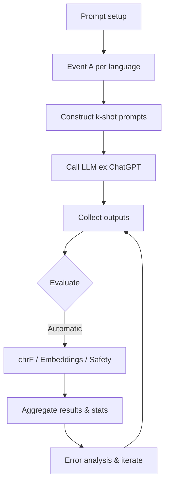

[Benchmark with existing translations](#benchmark-now-with-existing-human-translations)

[Evaluate translations from LLM using examples in prompts](#evaluate-translations-from-llm-using-examples-in-prompts)

# Benchmark with Existing Human Translations

## 1) Prepare Splits and Gold References

- If using data for training or fine-tuning:
  - Create a held-out test set and held-out evaluation set
  - (hash-based split by `doc_id`) as the canonical benchmark
- If not, entire set can be used as test
  
- Ensure each record includes:
    - `source_text`
    - `source_language`
    - `reference_translation` (human)
    - `translation_source` metadata

## 2) Baseline systems
  - Commercial APIs: Google Translate, DeepL, Azure Translator
  - Open-source models: NLLB, M2M-100, or mBART

  Note the version, parameters, preprocessing steps

## 3) Run Automatic MT Metrics

- Possible metrics:
    - sacreBLEU
    - chrF / chrF++
    - METEOR
    - COMET
    - BLEURT
    - BERTScore
- Report results per language and aggregated.
- Document exact preprocessing/tokenizer name and version.

## 3b) Optional:
  - Readability
  - evaluate small sample. track errors by type and severity
  - Translation error rate

## 3c) Optional: Run Domain-Aware Automatic Checks

- **Placeholder fidelity:** percent preserving placeholders exactly (regex: `r'{[^}]+}'`); treat as must-pass for operations.
- **Critical-term preservation:** verify key terms (e.g., “evacuate”, “shelter”, locations, times, phone numbers) appear in outputs.
- **Numeric/NER parity:** compare numbers, dates, and named entities between reference and system outputs.
- **Slot Error Rate (SER):**  
    `SER = (#missing + #incorrect slots) / total_slots`

## 5) Produce Summary Tables and Error Examples

- Probable table columns:
    - `#docs`, `#sentences`, `BLEU`, `chrF`, `COMET`, `Other Metrics`
    - `placeholder_fidelity(%)`, `critical_term_preserve(%)`,
    - `avg_tokens`, `vocab_size`
- Include representative failure examples per language and event type.
- If optional analysis is done in Step 3, provide error category breakdowns (e.g., omitted action, mistranslated location, placeholder corruption) with examples.

---
---

# Evaluate Translations from LLM Using Examples in Prompts    

## Overview
Use a shared prompting protocol with k‑shot examples drawn from Event A (translated into the target language) to produce Event B alerts in that language. Primary evaluation: automatic (chrF, sentence-embedding similarity) + safety checks.

## Model choices & inference settings

- Primary: ChatGPT-family (gpt-4o or gpt-4 if available; otherwise gpt-3.5-turbo for cost/latency).

- Suggested parameters:
  - temperature: 0.0, also test 0.2
  - top_p: 1
  - max_tokens: 200 (adjust if alerts longer)
  - presence_penalty and frequency_penalty: 0
  - system prompt: TBD

## Experimental conditions (TENTATIVE. REVIEW!)

  - k-shot: {0, 1, 3, 5}. A k-shot prompt includes k examples before asking the model to perform the target task.
  - For example: 
    - Use translated examples of Event A in LANG if available
    - Fallback: use English examples (label condition "en_examples").
    - If no examples exist for LANG, run zero-shot (k=0)

## Prompt template

Keep the prompts consistent. Obviously.

Example template:

    System: You are an alert-authoring assistant. Use the language and style of the examples below.
    User: "Examples (Event A):

    <example 1 for Event A in LANG>
    <example 2 for Event A in LANG>...
    Now produce a concise, actionable alert in LANG for Event B: [short metadata]. Keep it under 2 sentences and include clear actions."

Metadata fields: event type, severity (low/medium/high), audience (general/public/residents), etc. Include to enforce structure and comparability.

### Prompt and (possible) Result Example

k=1

    (Event A — Flood Warning):  
    “Flood Alert — Severe: Evacuate low‑lying areas now. Move to higher ground and follow instructions from local authorities.”  

    Generated (Event B — Severe Storm Warning):  
    “Storm Alert — High: Secure loose outdoor objects and stay indoors until authorities say it is safe.”

k=2

    You are an alert-authoring assistant.
    
    Example 1 (Flood): Input: Event: Flood; Severity: Severe; Audience: Coastal residents Output: Flood Alert — Severe: Evacuate low‑lying areas now. Move to higher ground and follow instructions from local authorities.
    Example 2 (Power outage): Input: Event: Power outage; Severity: Medium; Audience: Residents Output: Power Outage — Medium: Use flashlights, unplug appliances to prevent surges, and check updates from the utility provider.
    Now (Target): Input: Event: Storm; Severity: High; Audience: Residents near the coast
    
    Output:

## Sampling and dataset construction

For each (LANG, Event B): generate ouputs for up to `M = min(N_gold_B, 10)` 
Plan to generate outputs for each gold item or sample up to M=10 target items per language-event to limit cost while ensuring variety.
  - If event translations are missing for LANG, include: English example and zero-shot.

## Runs

- Pilot (see more below): 6 languages × ~10 events × 3 k values
- Full run: N languages x N(different N) events x 4? k values
  - Use additional models/temps

## Handling missing examples & class imbalance

- Build per‑language pools of Event A examples.
- If k > available examples, oversample (repeat) but mark as oversampled in metadata.
- To avoid model bias from dominant languages, consider balancing exemplars in the prompt construction process (repeat low-resource language examples proportionally when you prepare cross-language exemplar pools).

To avoid a tokenizer/representation bias toward high-resource languages, when training the prompt example set for a language with very few examples, oversample (and mark in metadata) its examples in the concatenated combined training text used for any subword modeling — but for pure prompting oversampling is just repeating lines in the prompt.

## Evaluations

### Automatic evaluation

- Surface and fluency:
  - chrF++ and BLEU
  - sentence-embedding cosine similarity (mBERT / LaBSE or sBERT)
- Instruction fidelity:
  - Keyword/action recall & precision (small multilingual lexicons per event)
- Safety:
  - Multilingual toxicity/safety checks; heuristics for hallucinated place names (e.g., invented lat/long or improbable locations)
- Novelty / copying:
  - Exact-match rate vs examples to detect copy behavior
- Tokenization sanity:
  - tokens_per_SOMETHING and average token counts to detect wrong script or transliteration

### Human evaluation
Human evaluation can (probably) be skipped because the gold standards were evaluated by the source agency.

## Baselines and comparisons

- Zero-shot (k=0)
- English-only examples
- Oracle: human-written Event B (gold)
- Optional: Compare model sizes small/large or open/closed

## Statistical tests & reporting

Bring out your big statistical brain and see what works for this:

- Metric comparisons: Wilcoxon signed‑rank test (nonparametric) or paired t‑test if distribution is normal  
- Categorical usability: McNemar’s test based on paired binary lables (usable/not, pass/fail) or Fisher’s exact test  
- Mixed-effects model suggestion:
  - `score ~ k + (1|language) + (1|event)` to control for language/event variance  
- Always report effect sizes and 95% CIs

## Error analysis & qualitative tagging

Tag sample failures with taxonomy:
- Wrong event ({A, C, D} instead of B)
- Hallucinated details (invented numbers/locations)
- Missing numbers/location
- Wrong register/script (transliteration or orthography issues)
- Missing key actions
- Copying example verbatim (template leakage)

For each language show representative examples and frequencies.

## Recommended parameters for the first pilot

| Item | Value |
|---|---|
| Pilot languages (higher resource) | English, Spanish, Simplified Chinese |
| Pilot languages (lower resource) | TBD, TBD, TBD |
| Source Events | ~10 common events (earthquake, flood, storm, wildfire, power outage, missing person, evacuation, shelter-in-place, boil-water, chemical spill) |
| Target Events | common event not included in source event text |
| k values | 0, 2 |
| Model | gpt-3.5-turbo, temperature=0.0 |
| Items per (lang,event) | up to 10 (or all gold if ≤10) |

<!-- 
- Languages for pilot:
  - Higher resource:English, Spanish (high resource), Simplified Chinese (logographic)
  - Lower resource: Amharic, Rohingya, Karen (low-resource).
- Events: choose XX common events present across many languages (e.g., earthquake, flood, storm, wildfire, power outage, missing person, evacuation, shelter-in-place, boil-water, chemical spill).
- k values: 0, 1, 3.
- Model: gpt-3.5-turbo with temperature 0.0. -->

## Practical notes for multilingual issues

- Explicitly request script choice in the instruction if languages have multiple orthographies (e.g., Traditional vs Simplified Chinese): "Use Traditional Chinese (繁體中文)".
- If transliterated (text changed to target language) results, add: "Do not transliterate; use native script" or "do not transliterate numbers or place names" 
  - For place names that should not be translated, put in brackets and use "do not translate anything in brackets"

## Workflow 

---

## Practical Tooling and Code Pointers

- **sacreBLEU:** `pip install sacrebleu` (record signature)
- **COMET:** use published checkpoints
- **Placeholder parity:** regex `r'{[^}]+}'` across source/reference/system

